# English Learning App Backend

## Overview

This backend is designed for an English learning application using a **microservices architecture**. Each service is independently deployed and communicates via API/gRPC and a message broker. The system includes database, cache, message queue, monitoring, and logging components for scalability and maintainability.

---

## Architecture Diagram

```mermaid
graph TB
    subgraph "Client Layer"
        Client[Web/Mobile Client]
    end

    subgraph "API Gateway"
        Traefik[Traefik API Gateway<br/>:80, :443<br/>TLS, Routing, Load Balancing]
    end

    subgraph "BFF Layer"
        BFF[BFF Service<br/>:8010<br/>Go/Gin<br/>API Composition & Aggregation]
    end

    subgraph "Microservices"
        UserService[User Service<br/>:8001<br/>Go/Gin<br/>Auth & User Management]
        LessonService[Lesson Service<br/>:8005<br/>Python/FastAPI<br/>Progress & Gamification]
        ContentService[Content Service<br/>:8004<br/>Go/GraphQL<br/>Content Management]
        NotificationService[Notification Service<br/>:8003<br/>Node.js/Express<br/>Email & Notifications]
        OrderService[Order Service<br/>:8006<br/>Go/Gin<br/>Payments & Orders]
    end

    subgraph "Data Layer"
        PostgreSQL[(PostgreSQL<br/>:5432<br/>User, Progress, Orders Data)]
        MongoDB[(MongoDB<br/>:27017<br/>Content & Media)]
        Redis[(Redis<br/>:6379<br/>Cache & Sessions)]
    end

    subgraph "Message Broker"
        RabbitMQ[RabbitMQ<br/>:5672, :15672<br/>Event Bus]
    end

    subgraph "Monitoring Stack"
        Prometheus[Prometheus<br/>:9090<br/>Metrics Collection]
        Grafana[Grafana<br/>:3000<br/>Dashboards & Alerts]
        Loki[Loki + Promtail<br/>:3100<br/>Log Aggregation]
        PGExporter[PostgreSQL Exporter<br/>:9187]
        RedisExporter[Redis Exporter<br/>:9121]
        RMQExporter[RabbitMQ Exporter<br/>:9419]
    end

    subgraph "External Services"
        S3[S3/MinIO<br/>Media Storage]
        Stripe[Stripe<br/>Payment Gateway]
        SMTP[SMTP/SendGrid<br/>Email Provider]
    end

    %% Client to Gateway
    Client -->|HTTPS| Traefik

    %% Gateway to Services
    Traefik -->|HTTP| BFF
    Traefik -->|HTTP| UserService
    Traefik -->|HTTP| LessonService
    Traefik -->|HTTP| ContentService
    Traefik -->|HTTP| NotificationService
    Traefik -->|HTTP| OrderService

    %% BFF to Services (Synchronous)
    BFF -->|HTTP| UserService
    BFF -->|HTTP| LessonService
    BFF -->|HTTP| ContentService
    BFF -->|HTTP| OrderService

    %% Services to Databases
    UserService -->|SQL| PostgreSQL
    LessonService -->|SQL| PostgreSQL
    OrderService -->|SQL| PostgreSQL
    ContentService -->|NoSQL| MongoDB
    ContentService -->|SQL| PostgreSQL

    %% Services to Cache
    UserService -->|Cache| Redis
    LessonService -->|Cache| Redis
    ContentService -->|Cache| Redis
    BFF -->|Cache| Redis
    OrderService -->|Cache| Redis

    %% Services to Message Broker (Asynchronous)
    UserService -.->|Publish Events| RabbitMQ
    LessonService -.->|Publish Events| RabbitMQ
    ContentService -.->|Publish Events| RabbitMQ
    OrderService -.->|Publish Events| RabbitMQ
    RabbitMQ -.->|Subscribe| NotificationService
    RabbitMQ -.->|Subscribe| LessonService
    RabbitMQ -.->|Subscribe| UserService

    %% External Integrations
    ContentService -->|Upload/Download| S3
    OrderService -->|Payment Processing| Stripe
    NotificationService -->|Send Email| SMTP

    %% Monitoring Connections
    PGExporter -->|Scrape| PostgreSQL
    RedisExporter -->|Scrape| Redis
    RMQExporter -->|Scrape| RabbitMQ
    
    Prometheus -->|Scrape Metrics| PGExporter
    Prometheus -->|Scrape Metrics| RedisExporter
    Prometheus -->|Scrape Metrics| RMQExporter
    Prometheus -->|Scrape Metrics| UserService
    Prometheus -->|Scrape Metrics| LessonService
    Prometheus -->|Scrape Metrics| ContentService
    Prometheus -->|Scrape Metrics| NotificationService
    Prometheus -->|Scrape Metrics| OrderService
    Prometheus -->|Scrape Metrics| BFF
    
    Grafana -->|Query| Prometheus
    Grafana -->|Query| Loki
    Loki -->|Collect Logs| UserService
    Loki -->|Collect Logs| LessonService
    Loki -->|Collect Logs| ContentService
    Loki -->|Collect Logs| NotificationService
    Loki -->|Collect Logs| OrderService
    Loki -->|Collect Logs| BFF

    %% Styling
    classDef gateway fill:#ff6b6b,stroke:#c92a2a,stroke-width:2px,color:#fff
    classDef service fill:#4dabf7,stroke:#1971c2,stroke-width:2px,color:#fff
    classDef database fill:#51cf66,stroke:#2f9e44,stroke-width:2px,color:#fff
    classDef messaging fill:#ffd43b,stroke:#f59f00,stroke-width:2px,color:#000
    classDef monitoring fill:#a78bfa,stroke:#7c3aed,stroke-width:2px,color:#fff
    classDef external fill:#ffa94d,stroke:#e67700,stroke-width:2px,color:#000
    
    class Traefik gateway
    class BFF,UserService,LessonService,ContentService,NotificationService,OrderService service
    class PostgreSQL,MongoDB,Redis database
    class RabbitMQ messaging
    class Prometheus,Grafana,Loki,PGExporter,RedisExporter,RMQExporter monitoring
    class S3,Stripe,SMTP external
```



### Legend
- **Solid Lines (→)**: Synchronous HTTP/gRPC communication
- **Dotted Lines (⋯→)**: Asynchronous event-driven communication via message broker
- **Colors**:
  - 🔴 **Red**: API Gateway
  - 🔵 **Blue**: Microservices
  - 🟢 **Green**: Data stores (PostgreSQL, MongoDB, Redis)
  - 🟡 **Yellow**: Message broker (RabbitMQ)
  - 🟣 **Purple**: Monitoring & Observability
  - 🟠 **Orange**: External services

---

## Core Services

### 1. User Service

- **Features:**
  - User registration, login, JWT authentication
  - Profile management (name, email, avatar)
  - Session management, refresh tokens, MFA
- **Purpose:** Acts as the identity provider for the system and centralizes authentication.

### 2. Content Service

- **Features:**
  - CRUD for learning content: lessons, flashcards, quizzes
  - Audio/image management (uploads to S3/MinIO)
  - Categorization by topic and level
- **Purpose:** Manages and distributes learning content.

### 3. Lesson/Progress Service

- **Features:**
  - Tracks user learning progress (streaks, scores)
  - Stores quiz results, updates leaderboards
  - Emits events when a user completes a lesson
- **Purpose:** Maintains user learning state and supports gamification.


### 4. Notification Service

- **Features:**
  - Sends email with html template
  - Tracks email delivery and status
  - Integrations: SMTP or SendGrid/Mailgun
- **Purpose:** Keeps users engaged & informed through timely notifications.

### 5. Order Service

- **Features:**
  - Payment processing with Stripe integration
  - Order management and tracking
  - Subscription and course purchase handling
  - Webhook handling for payment events
- **Purpose:** Manages monetary transactions and premium content access.

### 6. BFF Service

- **Purpose:** The Aggregator Service (also called API Composition Layer / Backend-for-Frontend) is responsible for combining data from multiple domain services (User, Lesson, Progress, Content, Order) into a single API response. Instead of the client making multiple calls, the aggregator merges responses and optimizes communication.


---

## Infrastructure Stack

- **PostgreSQL:**  
  Relational database for User and Progress Services. Stores user info, quiz results, and progress tracking.

- **MongoDB:**  
  NoSQL database suitable for storing lesson content as JSON, documents, and dynamic metadata.

- **Redis:**  
  In-memory cache for sessions, token storage, rate limiting, and leaderboards (using Sorted Sets).

- **RabbitMQ:**  
  Message broker for inter-service communication. Used to send events like `UserCreated` and `LessonCompleted` to Progress and Notification Services.

---

## API Gateway & Service Discovery

**API Gateway** (Traefik):

- Acts as a single entry point for all client requests
- Handles routing and load balancing across services
- Performs JWT verification and rate limiting
- Terminates TLS/SSL connections

**Service Discovery:**

- Uses Kubernetes Services or Consul for dynamic service registration and discovery
- Automatically registers and deregisters services to support scaling and resilience

---

## Monitoring & Observability

- **Prometheus:**  
  Collects metrics from services and exporters (CPU, RAM, DB connections, queue length).

- **Grafana:**  
  Visualizes metrics and logs. Dashboards for User, Content, and Lesson Services.

- **Loki + Promtail:**  
  Centralized log storage and querying. Promtail collects logs from containers and sends them to Loki. Grafana queries logs alongside metrics.

- **Exporters:**  
  - Postgres Exporter: Database metrics  
  - Redis Exporter: Redis metrics  
  - RabbitMQ Exporter: Queue metrics

---

## DevOps & Deployment

- **Docker Compose:**  
  Quickly launches the entire stack.

- **Kubernetes (optional):**  
  Scales services in production.

- **CI/CD Pipeline:**  
  Automates build, test, and deployment for each microservice.

---

## Communication Patterns

The architecture follows a hybrid communication pattern as shown in the [Architecture Diagram](#architecture-diagram) above:

### Synchronous Communication (HTTP/REST/GraphQL)
- **Client → Traefik → Services**: All external requests flow through the API gateway
- **BFF → Domain Services**: The BFF aggregates data by making HTTP calls to multiple services
- **Direct Service Access**: Services can be accessed directly through Traefik for specific operations

### Asynchronous Communication (Event-Driven)
- **RabbitMQ Message Broker**: Services publish events to RabbitMQ for decoupled, async operations
- **Event Examples**:
  - `UserCreated`: Published by User Service → Consumed by Notification Service
  - `LessonCompleted`: Published by Lesson Service → Consumed by Notification Service
  - `OrderCompleted`: Published by Order Service → Consumed by Lesson Service (unlock content)

### Data Flow Layers
1. **Gateway Layer**: Traefik handles security, routing, and TLS termination
2. **BFF Layer**: Aggregates and composes responses from multiple services
3. **Service Layer**: Domain services handle business logic independently
4. **Data Layer**: PostgreSQL, MongoDB, and Redis for persistence and caching
5. **Event Layer**: RabbitMQ for asynchronous inter-service communication

---

## Getting Started

### Prerequisites
- Docker and Docker Compose installed
- At least 8GB of RAM available
- Ports 80, 443, 3000, 5432, 6379, 8001-8010, 9090, 15672, 27017 available

### Quick Start

1. **Clone the repository**
   ```bash
   git clone <repository-url>
   cd english-learning-app
   ```

2. **Start the infrastructure stack**
   ```bash
   cd infrastructure
   docker-compose up -d
   ```

3. **Verify services are running**
   ```bash
   docker-compose ps
   ```

4. **Access the services**
   - **API Gateway (Traefik)**: http://localhost:80
   - **Traefik Dashboard**: http://localhost:8080
   - **Grafana**: http://localhost:3000 (admin/admin)
   - **Prometheus**: http://localhost:9090
   - **RabbitMQ Management**: http://localhost:15672 (user/password)
   - **pgAdmin**: http://localhost:5050 (admin@example.com/password)

5. **View logs**
   ```bash
   docker-compose logs -f [service-name]
   ```

6. **Stop the stack**
   ```bash
   docker-compose down
   ```

### Service Endpoints

Once running, the services are accessible through Traefik at:
- **User Service**: http://localhost/api/user
- **Lesson Service**: http://localhost/api/lesson
- **Content Service**: http://localhost/api/content
- **Notification Service**: http://localhost/api/notification
- **Order Service**: http://localhost/api/order
- **BFF Service**: http://localhost/api/bff

### Development

For detailed development instructions, see [CLAUDE.md](./CLAUDE.md) which includes:
- Service-specific build and run commands
- Database migration instructions
- Testing guidelines
- Architecture patterns and best practices

---

## Additional Documentation

- **[Authentication Guide](./authentication.md)**: JWT, MFA, and session management
- **[Admin Features](./admin.md)**: Admin panel and management features
- **[Frontend Integration](./FRONTEND_INTEGRATION_README.md)**: Guide for integrating with frontend applications
- **[Security Report](./security-report.md)**: Security audit and recommendations

---

## License

[Your License Here]

## Contributing

[Your Contributing Guidelines Here]